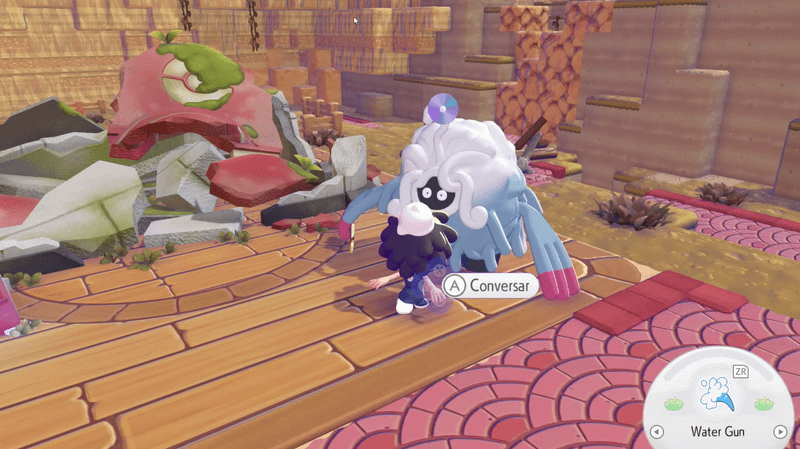
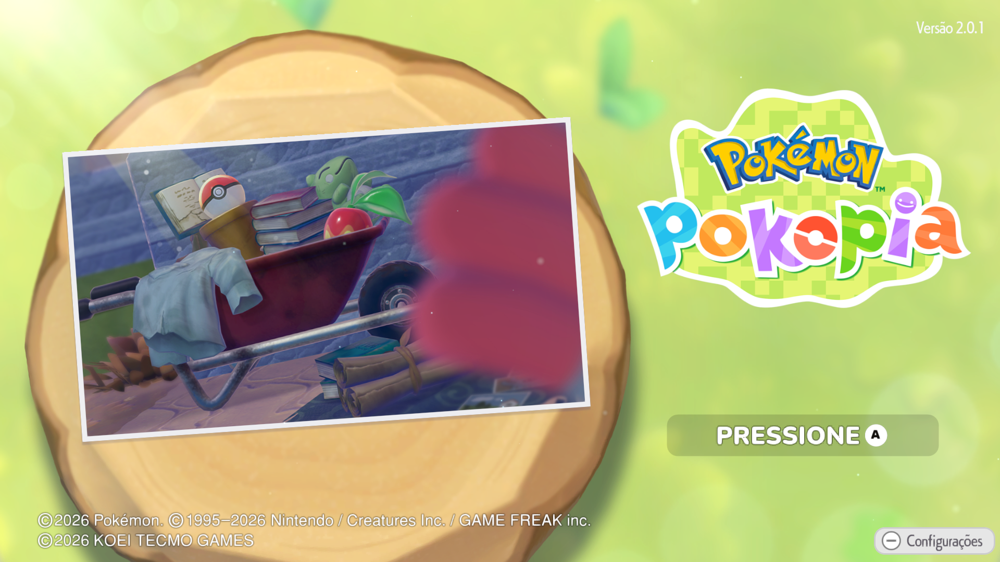
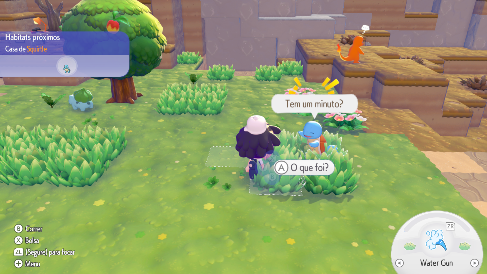
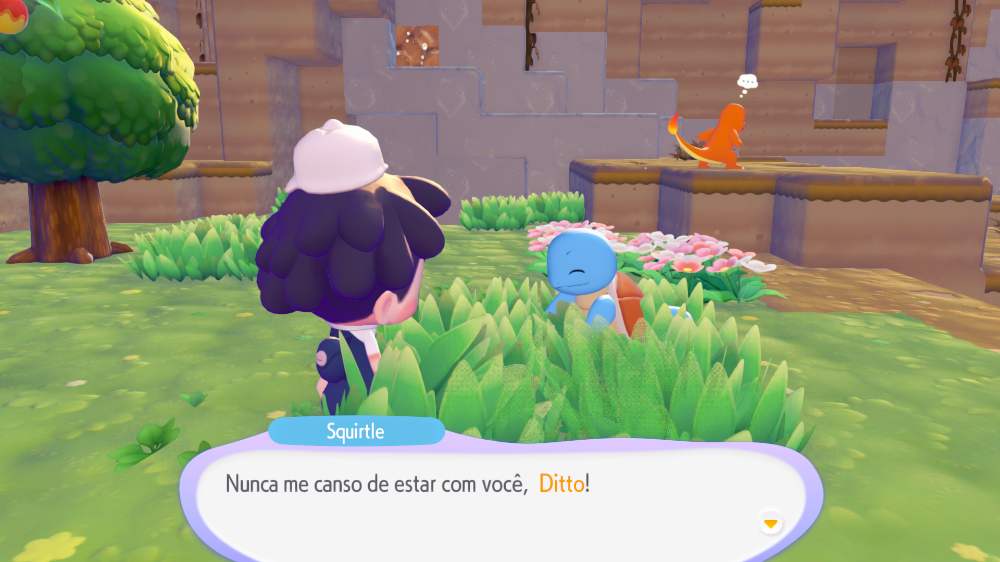

# 🇧🇷 Pokémon Pokopia — Tradução PT-BR beta 0.9

**Tradução não oficial de Pokémon Pokopia para Português Brasileiro**

Uma experiência Pokémon em nosso idioma!

---

## 📖 Sobre a tradução

Este projeto disponibiliza uma tradução não oficial de **Pokémon Pokopia** para **Português Brasileiro (PT-BR)**, permitindo que jogadores aproveitem a aventura com diálogos, menus e informações em português.

A tradução contempla:

- 💬 Diálogos e história
- 🎮 Menus e interface
- 🎒 Nomes e descrições de itens
- 📋 Missões, objetivos e tutoriais
- 🏡 Habitats e informações dos Pokémon
- 🖼️ Texturas e elementos visuais com texto

Os nomes oficiais de Pokémon, golpes e lugares são preservados.

A tradução foi desenvolvida com auxílio de inteligência artificial, ferramentas próprias e revisão manual.

---

## 📸 Imagens e demonstração

### 🎬 Gameplay traduzido

  

### 🖼️ Capturas de tela

**Tela inicial traduzida**

**Interface e gameplay**

**Diálogos em português**

---

## 📥 Download e instalação

### ⬇️ Baixar a tradução

Acesse a página de lançamentos para baixar a versão mais recente:

**[📦 Baixar Pokémon Pokopia PT-BR](https://github.com/LucasZOKA/Pokemon-Pokopia-PTBR/releases)**

### 📋 Requisitos

- Uma cópia legítima e compatível de Pokémon Pokopia.
- Um ambiente compatível com a instalação de mods LayeredFS.
- A versão do jogo 2.0.1a

🔧 Como instalar

Baixe o arquivo .zip da tradução na seção Releases.

Abra seu emulador e localize Pokémon Pokopia na lista de jogos.

Clique com o botão direito sobre o jogo.

Selecione Open Mod Data Location.

Extraia o conteúdo do .zip diretamente na pasta que foi aberta.

Pronto! Inicie o jogo e aproveite a tradução em Português Brasileiro! 🇧🇷

📁 Estrutura dos arquivos

Após a instalação, a estrutura deverá ficar assim:

Pasta de mods do jogo/
└── TraducaoBR/
    └── romfs/
        ├── LD_C0_R.BIN
        └── LI_C0_R.IDX

não extraia o mod dentro de uma pasta adicional. A pasta TraducaoBR deve ficar diretamente no local aberto pelo emulador.

Observação: a tradução foi desenvolvida para a versão compatível de Pokémon Pokopia indicada no lançamento.

**Importante:** o projeto disponibiliza apenas arquivos relacionados à tradução. O jogo original não está incluído.

---

## 🛠️ Ferramentas auxiliares

Durante o desenvolvimento da tradução, foram utilizadas ferramentas auxiliares ,também criadas por mim, para localizar editar e aplicar textos e recursos do jogo.

As ferramentas disponibilizadas neste repositório são independentes do download principal da tradução e destinam-se a usuários interessados em explorar ou trabalhar com os recursos compatíveis.

Todas as ferramentas são livres para modifica-las e usa-las como quiser.

### 📂 Downloads das ferramentas

Os arquivos das ferramentas ficam disponíveis na pasta:

**[📁 Acessar ferramentas](ferramentas/)**

Consulte as instruções de cada ferramenta antes de utilizá-la.

---

## 🐛 Encontrou algum problema na tradução?

Se você encontrar algum erro de tradução, texto em inglês, frase estranha, problema de formatação ou textura incorreta, pode nos ajudar a melhorar o projeto!

### 📝 Como reportar um problema

1. Acesse a aba **[Issues](https://github.com/LucasZOKA/Pokemon-Pokopia-PTBR/issues)** deste repositório.
2. Clique em **New issue**.
3. Descreva brevemente o problema encontrado.
4. **Anexe uma captura de tela** mostrando a frase, menu ou textura com o erro.
5. Se possível, informe em que parte do jogo o problema aconteceu.

### ❤️ Toda ajuda é bem-vinda!

Este é um projeto feito para a comunidade. Relatos de erros, sugestões de melhorias e contribuições são muito bem-vindos!

Cada problema reportado ajuda a tornar a tradução mais completa e natural para todos os jogadores. 🇧🇷

---

## ❤️ Créditos e agradecimentos

**Projeto e tradução PT-BR:** [LucasZOKA](https://github.com/LucasZOKA)

Tradução desenvolvida com auxílio de ferramentas de inteligência artificial e revisão manual.

Agradecimentos a todos que acompanham o projeto e contribuem com sugestões e relatos de problemas.

### ⚠️ Aviso legal

Este é um projeto independente, não oficial e sem afiliação com Nintendo, The Pokémon Company, GAME FREAK ou KOEI TECMO GAMES.

Pokémon e suas respectivas marcas e conteúdos pertencem aos seus titulares.

Este repositório não distribui o jogo original.
